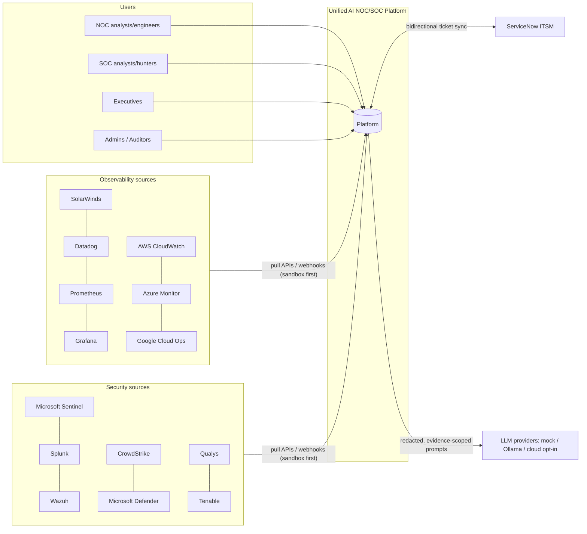
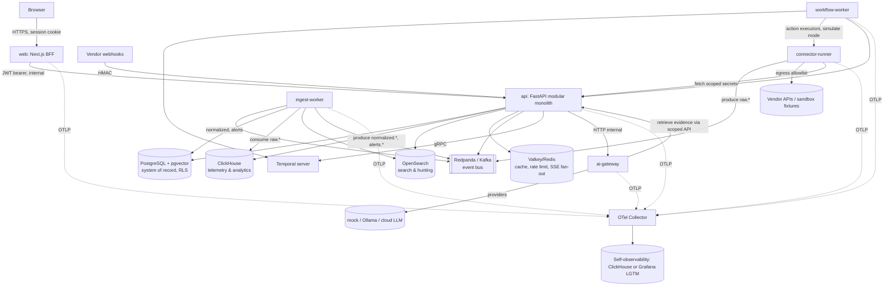

# 02 — Architecture

## 1. Architectural style

**A modular monolith at the core, plus a few separately deployed runtimes where isolation earns its cost.**

Why not microservices: one developer and one 16 GB PC. Microservices add network hops, deployment surface and distributed-debugging cost without benefit at this scale. Module boundaries are enforced in code (import-linter contracts), so any module can be extracted later.

Separately deployed runtimes (each with a clear isolation reason):

| Runtime | Why separate |
|---------|--------------|
| `api` (FastAPI) | The public API surface and the only process that serves the UI. |
| `ingest-worker` | Consumes Kafka; scales independently; must not block API latency. |
| `connector-runner` | Runs connector code (future third-party code), with **no DB credentials**, an egress allowlist, and access only to secrets for its assigned instances. |
| `ai-gateway` | Holds LLM provider keys, enforces redaction, budgets and the egress policy; the API never holds model keys. |
| `workflow-worker` (Temporal) | Durable playbook execution; its **action executors** are the only code that can call connector actions. |
| `web` (Next.js) | UI; BFF pattern for session cookies. |

## 2. System context (C4 level 1)



## 3. Containers (C4 level 2)



## 4. Backend module map (inside `backend/`)

| Module | Responsibility | Owns tables |
|--------|----------------|-------------|
| `core.identity` | Users, auth, MFA, sessions, API keys | users, credentials, sessions, api_keys |
| `core.tenancy` | Tenants, memberships, tenant context | tenants, memberships |
| `core.authz` | RBAC/ABAC policy evaluation | roles, permissions, role_bindings |
| `core.audit` | Hash-chained audit log | audit_log |
| `core.secrets` | Envelope encryption, SecretsProvider abstraction | secrets |
| `integrations` | Connector definitions/instances, health, checkpoints, webhook ingress | connector_* |
| `ingestion` | Normalization, dedup, enrichment (consumer logic used by ingest-worker) | — (writes alerts/events) |
| `assets` | Asset/CI inventory, identity resolution, topology | assets, asset_* |
| `alerts` | Alert lifecycle, suppression, maintenance windows | alerts, alert_*, maintenance_windows |
| `incidents` | Incidents, timeline, tasks, SLA, correlation engine | incidents, incident_* |
| `vulns` | Vulnerability findings (Qualys/Tenable) | vulnerabilities, findings |
| `automation` | Playbook definitions, action catalog, action requests, approvals, policy | playbooks, action_*, approvals |
| `ai` | AI tasks orchestration, evidence assembly, citation validation, AI output storage | ai_runs, ai_citations, knowledge_* |
| `analytics` | KPI/metrics queries (ClickHouse), reports, command center | — |
| `search` | OpenSearch query façade (tenant-pinned) | — |
| `notifications` | In-app, email (dev: MailHog/Mailpit), webhooks out | notifications |

Rule: modules talk through **service interfaces and domain events**, never through each other's tables.

## 5. Key data flows

### 5.1 Ingestion (pull)
1. The scheduler (in `connector-runner`) triggers `fetch(since=checkpoint)` for an instance.
2. The connector returns raw records plus a new cursor. The runner publishes to `raw.<vendor>` with headers `tenant_id`, `connector_instance_id`, `trace_id` and `schema_version`.
3. `ingest-worker` consumes the records, calls the connector's `normalize()` (pure, sandboxed function), validates against the schema, computes the fingerprint, and enriches with assets.
4. It writes to ClickHouse (all events), Postgres (alerts and assets only), and OpenSearch (searchable security/log events), then publishes `alerts.upserted`.
5. The correlation consumer evaluates rules and creates or updates incidents, publishing `incidents.changed`.
6. The API's SSE fan-out (Valkey pub/sub) pushes updates to the UI.
7. The checkpoint is committed **after** a successful publish (at-least-once; consumers are idempotent by `(tenant_id, source, source_event_id)`).

### 5.2 Webhook (push)
`POST /api/v1/ingest/webhooks/{connector_instance_id}` → HMAC verify + replay check → publish to `raw.<vendor>` → same pipeline. The webhook handler never parses deeply or writes to the DB directly.

### 5.3 AI analysis (evidence-grounded)
```mermaid
sequenceDiagram
  participant U as Analyst (UI)
  participant API as api (ai module)
  participant AIG as ai-gateway
  participant LLM as Provider (mock/Ollama/cloud)
  U->>API: POST /incidents/{id}/ai/summary
  API->>API: authz + tenant ctx; assemble evidence set (alerts, events, assets, runbooks via pgvector) → evidence IDs E1..En
  API->>AIG: task=incident_summary, evidence[], policy(tenant)
  AIG->>AIG: redact per tenant policy; budget check; wrap evidence as untrusted data
  AIG->>LLM: prompt (template vX) with structured-output schema
  LLM-->>AIG: JSON {claims:[{text, citations:[E..]}], confidence, gaps}
  AIG-->>API: output + usage
  API->>API: validate: schema, every claim cites ⊆ retrieved IDs, no action execution; else downgrade to "insufficient evidence"
  API->>API: persist ai_run + citations; audit
  API-->>U: rendered claims with clickable citations
```

### 5.4 Action with approval
1. A human or the AI proposes an action. An `ActionRequest` is created with tier, target, parameters and justification.
2. The policy engine evaluates tier, tenant policy, the target asset's criticality, the kill switch and the execution mode. The decision is `auto | approve_1 | approve_2 | deny`.
3. If approval is needed, an Approval task appears in the Approvals inbox. Approvers must be distinct from the requester and from each other, MFA step-up is required, and approvals expire (default 30 min).
4. Once approved, the Temporal workflow runs an `execute_action` activity in the workflow worker. The worker first claims the request from the API, which re-checks the approvals and the kill switch in the database. It then runs the sandbox connector's action with `mode=simulate` (or `dry_run`), and the result, including before/after state, goes back to the API. *(As built in P5: executors run in the worker, which has the connector runner's isolation.)*
5. The timeline, audit log and notifications are updated.

## 6. Cross-cutting concerns

### 6.1 Tenancy enforcement (defense in depth)
| Layer | Mechanism |
|-------|-----------|
| Auth token | `tid` (active tenant) claim; switching tenant issues a new token after a membership check. |
| API | `TenantContext` dependency; every repository method requires it. |
| PostgreSQL | `tenant_id` on every tenant-owned table; **RLS with `FORCE ROW LEVEL SECURITY`**; the app connects as a non-owner role; `SET LOCAL app.tenant_id` per transaction; the policy is `tenant_id = app_tenant()`. Role model: **ADR-0018**. |
| ClickHouse | `tenant_id` first in the `ORDER BY` key; row policies per DB user plus a mandatory query builder that injects the tenant filter. |
| OpenSearch | Index-per-tenant (`t-{tenant_short}-events-*`); the query façade only resolves aliases for the context tenant. |
| Kafka | `tenant_id` in the message key and header; consumers verify it against the connector-instance ownership. |
| Object/AI | The evidence assembler only queries through tenant-scoped repositories. |

### 6.2 AuthN/AuthZ
- **Browser:** opaque API session token in an HttpOnly, SameSite=Strict cookie held by the Next.js BFF and forwarded server-side; revocation is immediate. Mutations are Server Actions (Origin/Host check). See **ADR-0017** (this replaced the planned BFF-to-API JWT).
- **Machine:** API keys (hashed, prefixed `nsk_`) or OAuth2 client credentials (later).
- **Authorization:** permissions `resource:action[:scope]`; roles bundle permissions; bindings are `(user, tenant, role)`. ABAC conditions (portal, risk tier, asset criticality) live in the policy engine. In-process Python policy engine with an OPA-compatible interface so it can be swapped later.
- **Step-up MFA** for approvals, secret changes, role changes and the kill switch.

### 6.3 Secrets management
- A `SecretsProvider` interface with implementations: `LocalEnvelopeProvider` (Phase 1: AES-256-GCM data keys wrapped by a master key loaded from a Docker secret file, never in env vars or the repo) and `OpenBaoProvider` / `VaultProvider` / cloud KMS later.
- Connector credentials are write-only through the API. The connector-runner fetches them over an internal mTLS/authenticated channel, scoped to the instances it runs, and they are held in memory only.
- A `detect-secrets`/`gitleaks` pre-commit hook and CI scan.

### 6.4 Audit
Every audit row holds `prev_hash` and `hash = SHA-256(prev_hash || canonical_json(row))`, chained per tenant. The DB role has INSERT-only on `audit_log` (no UPDATE/DELETE grants), plus a periodic anchor (hash checkpoint) exported to a file outside the DB.

### 6.5 Observability of the platform itself
OpenTelemetry SDKs in Python and Next.js → OTel Collector. Dev default: the collector exports to a lightweight backend (Grafana LGTM all-in-one image, `observability` profile) or to ClickHouse. The trace context is propagated in Kafka headers and Temporal headers.

### 6.6 AI gateway design
- **Provider adapters:** `mock`, `ollama`, `anthropic`, `openai`, `azure_openai`, with a common interface `generate(task, messages, schema, params) → {output, usage}`.
- **Routing per tenant and task** (e.g. a fast model for alert summaries, a stronger model for RCA). If a cloud provider is configured, examples are `claude-sonnet-5-5` for triage and `claude-opus-5-5` for deep investigation. These are configuration, not code.
- **Prompt templates** are versioned files in `ai-engine/prompts/` and tested by the eval harness.
- **Guards:** a redaction pipeline (secrets, PII patterns, tenant-configurable fields), max-token and budget limits, structured-output enforcement, and **no tool execution capability**. Only read-only retrieval tools are exposed, and those run through the API with the tenant context.
- **Embeddings** for runbooks/knowledge go into pgvector (local embedding model through Ollama, or the `mock` hash embeddings in dev).

## 7. Deployment profiles (Docker Compose)

| Profile | Services | Approx RAM (capped) | Used from |
|---------|----------|---------------------|-----------|
| `core` | postgres(+pgvector), valkey, api, web, mailpit | ~2.5–3.5 GB | P1 |
| `stream` | redpanda (single node, `--smp 1 --memory 1G`), redpanda-console (optional), ingest-worker, connector-runner | +1.5 GB | P2 |
| `analytics` | clickhouse (capped `max_server_memory_usage`) | +1–1.5 GB | P2 |
| `workflow` | temporal (dev server, SQLite volume; as built in P5), workflow-worker | +~0.2 GB measured | P5 |
| `ai` | ai-gateway; optional `ollama` (CPU-only small models; big RAM cost) | +0.3 GB (+4–8 GB w/ Ollama) | P4 |
| `search` | opensearch single-node (`-Xms512m -Xmx512m`, security plugin on) + one-shot `opensearch-setup`; no dashboards (as built in P6) | +~1.2 GB measured | P6 |
| `observability` | grafana/otel-lgtm v0.41 (collector, Prometheus, Tempo, Loki, Grafana), platform dashboard and SLO rules (as built in P7) | +~1.2 GB measured | P7 |
| `sso` | Keycloak 26.4 dev server with a DEMO realm (optional OIDC sign-in) | +~0.6 GB | P7 |
| `tools` | one-shot `audit-verify` | — | P7 |
| hardened override | `hardened.override.yml`: TLS on Postgres/Valkey/ClickHouse/OpenSearch/API/AI gateway, Caddy TLS edge, OpenBao + setup job, secure cookies | +~0.2 GB | P7 |

All ports bind to `127.0.0.1` (API host port 8100 by default; see `.env`). Named volumes, retention TTLs on ClickHouse tables, and Redpanda retention (e.g. 24 h / 2 GB in dev).

> Ollama together with the full stack will not fit in 16 GB. Use `mock`, or Ollama with a small model and the `search` profile off.

## 8. Technology choices (summary; details and alternatives in [10](10-decisions-for-approval.md))

| Concern | Choice | Rationale |
|---------|--------|-----------|
| Frontend | Next.js (App Router) + TypeScript + Tailwind + shadcn/ui (Radix) + TanStack Query + ECharts | Mature, accessible primitives; ECharts handles dense ops charts. |
| API | FastAPI + Pydantic v2 + SQLAlchemy 2 (async) + Alembic | Typed, OpenAPI 3.1 generation. |
| Contract | OpenAPI → generated TS client (`openapi-typescript`) | Single source of truth. |
| System of record | PostgreSQL 16/17 + pgvector | RLS, JSONB, vectors without another DB. |
| Telemetry/analytics | ClickHouse | Columnar, TTLs, fast aggregations for KPIs. |
| Search/hunting | OpenSearch (Apache-2.0) | Full-text/IOC search, hunting queries. **Deferred to P6**; Postgres FTS before that. |
| Cache/pubsub | Valkey (BSD; Redis-protocol compatible) | Avoids Redis license ambiguity; drop-in. |
| Event bus | Redpanda single-node (dev) — Kafka API | Light. **Licensing note:** BSL; Apache Kafka (KRaft) is the swap-in. The code uses only the Kafka API (`confluent-kafka`/`aiokafka`). |
| Workflows | Temporal (Python SDK) | Durable execution, signals for approvals, timers for expiry. |
| Telemetry of platform | OpenTelemetry | Vendor-neutral. |
| Testing | pytest, Hypothesis, Testcontainers, Playwright, Vitest, Schemathesis (API fuzz) | — |
| Quality/security CI | ruff, mypy (strict on core), eslint, tsc, import-linter, bandit, semgrep, pip-audit, npm audit, gitleaks, trivy (images), syft SBOM | — |

## 9. Repository layout

```
AI-NOC-SOC/
├─ frontend/                 # Next.js app (portals: (noc), (soc), (command), (admin))
├─ backend/                  # FastAPI modular monolith + ingest-worker entrypoint
│  ├─ app/core/{identity,tenancy,authz,audit,secrets}/
│  ├─ app/modules/{integrations,ingestion,assets,alerts,incidents,vulns,automation,ai,analytics,search,notifications}/
│  ├─ migrations/            # Alembic (Postgres) + ClickHouse SQL migrations
│  └─ workers/ingest.py
├─ connectors/
│  ├─ sdk/                   # `nocsoc-connector-sdk` Python package (contract, base classes, testing kit)
│  ├─ runner/                # connector-runner service
│  └─ catalog/<vendor>/      # one package per connector: manifest, config schema, normalize, fixtures
├─ ai-engine/
│  ├─ gateway/               # ai-gateway service (provider adapters, redaction, budgets)
│  ├─ prompts/               # versioned templates
│  └─ evals/                 # golden datasets + harness
├─ automation/
│  ├─ worker/                # Temporal workflow-worker, action executors
│  └─ playbooks/             # sample playbook definitions
├─ infrastructure/
│  ├─ compose/               # docker-compose.yml + profile overlays
│  ├─ config/                # clickhouse/, opensearch/, otel/, temporal/ configs
│  └─ secrets/               # .gitignored; generated by scripts/bootstrap
├─ scripts/                  # bootstrap, seed, reset, verify-audit, gen-client (PowerShell + sh)
├─ tests/                    # cross-service: e2e (Playwright), isolation suite, security, load (k6)
└─ docs/
```

## 10. Scaling path (not built now, design keeps it open)
- Stateless `api`/workers → horizontal scaling under Kubernetes.
- Postgres → managed Postgres with read replicas, or Citus if tenant volume demands.
- Large tenants → dedicated ClickHouse/OpenSearch clusters (the tenant-routing table already supports this).
- Kafka partitions keyed by `tenant_id:source`.
