# 03 — Data Model

Conventions (PostgreSQL):
- Primary keys are `uuid` named `id`. P1 uses `gen_random_uuid()` (v4); PostgreSQL 17 has no native UUIDv7. Switch when PostgreSQL 18 or an extension is adopted.
- Every tenant-owned table has `tenant_id uuid NOT NULL` + RLS policy + composite indexes leading with `tenant_id`.
- `created_at`, `updated_at timestamptz`; `version int` for optimistic concurrency (ETag).
- Soft delete only where business-required (`deleted_at`); audit and timeline are never deleted by the app.
- Enums as Postgres `text` + CHECK constraints (easier migrations than native enums).
- JSONB for vendor-specific payloads (`raw`, `attributes`), never for fields that are queried in hot paths.

## 1. Entity-relationship overview (PostgreSQL)

```mermaid
erDiagram
  TENANT ||--o{ TENANT : "parent_of (MSP)"
  TENANT ||--o{ MEMBERSHIP : has
  USER ||--o{ MEMBERSHIP : has
  MEMBERSHIP ||--o{ ROLE_BINDING : grants
  ROLE ||--o{ ROLE_BINDING : used_in
  ROLE }o--o{ PERMISSION : bundles
  TENANT ||--o{ CONNECTOR_INSTANCE : configures
  CONNECTOR_DEFINITION ||--o{ CONNECTOR_INSTANCE : instantiates
  CONNECTOR_INSTANCE ||--o{ CONNECTOR_CHECKPOINT : tracks
  CONNECTOR_INSTANCE ||--o{ CONNECTOR_RUN : logs
  CONNECTOR_INSTANCE }o--|| SECRET : uses
  TENANT ||--o{ ASSET : owns
  ASSET ||--o{ ASSET_IDENTIFIER : known_as
  ASSET ||--o{ ASSET_RELATION : links
  SERVICE ||--o{ ASSET : composed_of
  ALERT }o--o| ASSET : about
  ALERT ||--o{ ALERT_EVIDENCE : has
  INCIDENT ||--o{ INCIDENT_ALERT : groups
  ALERT ||--o{ INCIDENT_ALERT : member_of
  INCIDENT ||--o{ TIMELINE_ENTRY : history
  INCIDENT ||--o{ INCIDENT_TASK : has
  INCIDENT ||--o{ EXTERNAL_TICKET : synced_to
  INCIDENT ||--o{ ACTION_REQUEST : triggers
  ACTION_REQUEST ||--o{ APPROVAL : needs
  ACTION_REQUEST }o--|| ACTION_CATALOG_ITEM : of_type
  PLAYBOOK ||--o{ PLAYBOOK_VERSION : versions
  PLAYBOOK_VERSION ||--o{ WORKFLOW_RUN : executes
  AI_RUN ||--o{ AI_CITATION : cites
  INCIDENT ||--o{ AI_RUN : analyzed_by
  KNOWLEDGE_DOC ||--o{ KNOWLEDGE_CHUNK : chunked
  TENANT ||--o{ AUDIT_LOG : records
```



## 2. PostgreSQL tables

> **Implemented in P1** (migration `0001`): tenants, users, user_credentials, sessions, auth_challenges, memberships, invitations, permissions, roles, role_permissions, role_bindings, delegations, api_keys, audit_log. The `secrets` table arrives with connector credentials in P2 (P1 encrypts TOTP seeds in `user_credentials` with the envelope provider). `tenant_admin` holds every permission (MSP-only ones are inert in customer tenants). Database roles: ADR-0018.

### 2.1 Identity & tenancy (`core`)

| Table | Key columns | Notes |
|-------|-------------|-------|
| `tenants` | id, kind(`msp/customer`), parent_tenant_id (customer → its MSP; NULL for MSP), slug (unique), name, status(`active/suspended`), data_region, settings jsonb, created_at | Not RLS-scoped (platform table); access via memberships/delegations only. CHECK: customers have an MSP parent; MSPs have none. |
| `delegations` | id, msp_tenant_id, customer_tenant_id, msp_role_id (who in the MSP receives it), customer_role_id (what they get in the customer), aggregate_read bool, expires_at, created_by, revoked_at, revoked_by | Visible to both tenants; customer admin can revoke. Customer must be a child of the MSP. |
| `users` | id, email (citext unique), display_name, status, is_platform_admin, mfa_enrolled, last_login_at | Global identity. |
| `user_credentials` | user_id, type(`password/totp/webauthn`), secret_hash/enc, created_at | Argon2id for password; TOTP seed encrypted via secrets provider. |
| `sessions` | id, user_id, active_tenant_id, created_at, expires_at, ip, user_agent, revoked_at | Server-side sessions (BFF). |
| `memberships` | id, tenant_id, user_id, status, invited_by | RLS. |
| `roles` | id, tenant_id NULL (=system role), name, description, is_system | System roles are read-only. |
| `permissions` | key (`incident:update`), description, risk_level | Static catalog seeded by migration. |
| `role_permissions` | role_id, permission_key | |
| `role_bindings` | id, tenant_id, membership_id, role_id, portal_scope NULL | RLS. |
| `api_keys` | id, tenant_id, name, prefix, key_hash, permissions text[], expires_at, last_used_at, revoked_at, created_by | RLS. |

**System roles (seeded):** `tenant_admin`, `integration_admin`, `noc_analyst`, `noc_engineer`, `soc_analyst_l1`, `soc_analyst_l2`, `threat_hunter`, `incident_commander`, `approver`, `executive_viewer`, `auditor`. `platform_admin` is a user flag, not a tenant role, and grants tenant administration only. **Reading tenant data requires a membership** (break-glass membership is time-boxed and audited).

### 2.2 Secrets
| Table | Key columns | Notes |
|-------|-------------|-------|
| `secrets` | id, tenant_id, kind(`connector_credential/webhook_hmac/ai_provider_key`), provider(`local/openbao`), ciphertext, wrapped_dek, key_version, created_by, rotated_at | Never selected by API read paths; only the `core.secrets` service can decrypt. |

### 2.3 Integrations
| Table | Key columns | Notes |
|-------|-------------|-------|
| `connector_definitions` | id (`crowdstrike.falcon`), vendor, product, category(`observability/siem/edr/vuln/itsm/cloud`), sdk_version, version, certification(`sandbox/contract-tested/live-verified`), manifest jsonb | Global catalog, loaded from `connectors/catalog`. |
| `connector_instances` | id, tenant_id, definition_id, name, mode(`sandbox/live`), config jsonb (non-secret), secret_id, enabled, schedule, status(`healthy/degraded/failing/disabled`), last_success_at, last_error | RLS. `mode=live` blocked by policy unless certification=`live-verified` and platform flag set. |
| `connector_checkpoints` | instance_id, stream (`alerts`,`metrics`,…), cursor jsonb, updated_at | |
| `connector_runs` | id, tenant_id, instance_id, stream, started_at, finished_at, status, records_in, records_out, error_class, error_detail(sanitized) | Partitioned monthly. |
| `webhook_endpoints` | id, tenant_id, instance_id, secret_id, last_received_at | |
| `webhook_nonces` | tenant_id, instance_id, nonce, received_at | Or Valkey with TTL (preferred); table as fallback. |

### 2.4 Assets & topology
| Table | Key columns | Notes |
|-------|-------------|-------|
| `assets` | id, tenant_id, type(`host/vm/container/network_device/database/app/cloud_resource/identity/…`), name, criticality(1–5), environment(`prod/stage/dev`), owner_team, attributes jsonb, first_seen, last_seen | RLS. |
| `asset_identifiers` | tenant_id, asset_id, kind(`hostname/fqdn/ip/mac/cloud_id/agent_id/serial/upn`), value, source_instance_id | Unique (tenant_id, kind, value) — identity resolution. |
| `asset_relations` | tenant_id, from_asset_id, to_asset_id, relation(`runs_on/depends_on/connects_to/member_of`), source | Topology graph (recursive CTE for impact). |
| `services` | id, tenant_id, name, tier, owner_team, slo jsonb | Business services. |
| `service_assets` | service_id, asset_id | |
| `maintenance_windows` | id, tenant_id, scope (asset/service ids, tags), starts_at, ends_at, reason, created_by | |

### 2.5 Alerts
| Table | Key columns | Notes |
|-------|-------------|-------|
| `alerts` | id, tenant_id, domain(`noc/soc`), source_instance_id, source_alert_id, fingerprint, title, description, severity(`info/low/medium/high/critical`), status(`new/acknowledged/in_progress/resolved/closed/suppressed`), category, asset_id, service_id, first_seen, last_seen, occurrence_count, mitre_tactics text[], mitre_techniques text[], normalized jsonb, raw_ref (ClickHouse/OpenSearch event id), assigned_to | RLS. Unique (tenant_id, fingerprint) WHERE status NOT IN (resolved, closed). Partition by month on `first_seen` once volume warrants. |
| `alert_evidence` | id, tenant_id, alert_id, kind(`event/metric_window/log_query/ioc/enrichment`), ref, summary, captured_at | Evidence objects addressable by AI citations. |
| `alert_state_changes` | id, tenant_id, alert_id, from_status, to_status, actor, reason, at | |
| `suppression_rules` | id, tenant_id, match jsonb, reason, expires_at, created_by | |

**As built in P3 (migration 0003):**
- **Topology:** `services` (name, tier, owner_team, aliases, external_ref) and `service_assets` (role `member` or `dependency`) come from the ServiceNow sandbox CMDB stream (`ServiceV1`, SDK 1.1). A service's dependencies stand in for `asset_relations`; a general asset graph is deferred.
- **Alerts:** `alerts` gains `service_id`, `suppression_reason` and a generated `search` tsvector.
- **Incidents:** `incidents` adds `merged_into_id` (correlation merged it; it is closed and excluded from KPIs), `created_by_type` and a `search` tsvector. `incident_counters` allocates per-tenant numbers.
- **Per-tenant settings:** `sla_policies` and `correlation_overrides` hold one row per tenant; defaults live in code, so no table needs rows without a tenant.

### 2.6 Incidents
| Table | Key columns | Notes |
|-------|-------------|-------|
| `incidents` | id, tenant_id, number (per-tenant sequence, e.g. `INC-000123`), domain(`noc/soc/joint`), title, summary, severity, priority(P1–P4), status(`open/investigating/contained/mitigated/resolved/closed`), commander_id, assignee_id, team, impacted_service_ids uuid[], detected_at, acknowledged_at, resolved_at, closed_at, sla_policy_id, correlation_key, version | RLS. |
| `incident_alerts` | tenant_id, incident_id, alert_id, added_by(`correlation/user`), rule_id, added_at | |
| `timeline_entries` | id, tenant_id, incident_id, kind(`state_change/comment/alert_added/ai_analysis/action_requested/action_result/approval/external_sync/task`), actor_type(`user/system/ai/connector`), actor_id, body jsonb, at | Append-only (no UPDATE grant). |
| `incident_tasks` | id, tenant_id, incident_id, title, status, assignee_id, due_at, runbook_ref | |
| `external_tickets` | id, tenant_id, incident_id, system(`servicenow`), external_id, external_number, sync_state, last_synced_at, last_sync_origin | Loop prevention. |
| `sla_policies` | id, tenant_id, name, targets jsonb (ack/resolve per priority) | |
| `correlation_rules` | id, tenant_id NULL(=default), name, domain, definition jsonb, enabled, version | |
| `post_incident_reviews` | id, tenant_id, incident_id, content jsonb, ai_run_id, review_status(`ai_draft/in_review/approved`) | |

### 2.7 Vulnerabilities
| Table | Key columns |
|-------|-------------|
| `vulnerability_defs` | id (CVE or vendor QID/plugin), cvss_v3, cvss_v4, epss, kev (bool), title, published_at — global |
| `vulnerability_findings` | id, tenant_id, asset_id, vuln_def_id, source_instance_id, status(`open/fixed/accepted/false_positive`), first_found, last_found, risk_score — RLS |

### 2.8 Automation
| Table | Key columns | Notes |
|-------|-------------|-------|
| `action_catalog` | key (`edr.isolate_host`), connector_capability, tier(`T0–T3`), params_schema jsonb, reversible bool, reverse_action_key | Global; tenants can override tier upward only. |
| `tenant_action_policies` | tenant_id, action_key, tier_override, allowed bool, require_justification | |
| `playbooks` / `playbook_versions` | id, tenant_id, name, domain, trigger jsonb; version, definition jsonb (DSL), status(`draft/published/retired`), published_by | Versioned; runs pin a version. |
| `workflow_runs` | id, tenant_id, playbook_version_id, temporal_workflow_id, incident_id, status, started_at, ended_at, triggered_by | |
| `action_requests` | id, tenant_id, incident_id, workflow_run_id, action_key, target jsonb, params jsonb, tier, requested_by_type(`user/ai/playbook`), requested_by, justification, policy_decision jsonb, execution_mode(`dry_run/simulate/live`), status(`pending_approval/approved/denied/expired/executing/succeeded/failed/cancelled`), result jsonb, created_at | |
| `approvals` | id, tenant_id, action_request_id, approver_id, decision(`approve/deny`), comment, mfa_verified_at, decided_at | Unique (action_request_id, approver_id); check approver ≠ requester. |
| `kill_switches` | scope(`global/tenant`), tenant_id, engaged bool, engaged_by, reason, at | |

**As built in P5 (migration 0005):**
- The catalog is code (connector manifests plus platform actions), not a table.
- Tables: `action_policies`, `playbooks`, `playbook_versions`, `workflow_runs` (with `steps` jsonb per step), `action_requests`, `approvals`, and `tenant_kill_switches`, all FORCE RLS. There is also `global_kill_switch` (one row, platform-wide, changed only through `set_global_kill_switch()`).
- `action_requests.execution_mode` is constrained to `dry_run` and `simulate`; `live` is not storable.
- Each request has a unique `(tenant_id, idempotency_key)`.
- Triggers: `approval_guard` rejects approver = requester, and the application role has no UPDATE on `approvals`. `playbook_version_guard` makes published and retired versions immutable and undeletable.

### 2.9 AI
| Table | Key columns | Notes |
|-------|-------------|-------|
| `ai_runs` | id, tenant_id, task(`alert_summary/incident_summary/triage/rca/query_assist/pir_draft/chat`), subject_type, subject_id, provider, model, prompt_template_id, prompt_template_version, input_evidence_ids uuid[], output jsonb, validation_status(`grounded/partially_grounded/insufficient_evidence/rejected`), confidence, tokens_in, tokens_out, cost_usd, latency_ms, requested_by, created_at | Full prompt stored only if tenant enables "store prompts" (may contain sensitive data). |
| `ai_citations` | ai_run_id, tenant_id, claim_index, evidence_type, evidence_id | |
| `ai_feedback` | id, tenant_id, ai_run_id, user_id, rating(`up/down`), reason | Feeds evals. |
| `ai_tenant_settings` | tenant_id, provider_routing jsonb, cloud_egress_allowed bool, redaction_policy jsonb, monthly_budget_usd, store_prompts bool | |
| `knowledge_docs` | id, tenant_id, kind(`runbook/kb/postmortem`), title, source, body, version | |
| `knowledge_chunks` | id, tenant_id, doc_id, ordinal, text, embedding vector(N), embedding_model | HNSW index per embedding model dimension. |

**As built in P4 (migration 0004):**
- **AI tables:** `ai_settings` (one row per tenant: provider, `allow_cloud`, `redact_pii`, `daily_token_budget`; the CHECK makes `anthropic` require `allow_cloud`), `ai_runs` (append-only for the app; stores the evidence index, the validated output, `validation_status` and notes, token usage and redaction counts; the raw prompt is not stored), `ai_citations`, and `ai_feedback`.
- **Knowledge base:** `knowledge_docs` and `knowledge_chunks` (`vector(256)`, HNSW cosine index, `embedding_model` `hash-256-v1`). All of them are FORCE RLS.

### 2.10 Audit & notifications
| Table | Key columns | Notes |
|-------|-------------|-------|
| `audit_log` | id bigserial, tenant_id NULL(platform), at, actor_type, actor_id, actor_ip, action (`auth.login.success`, `connector.secret.update`, `action.approve`…), target_type, target_id, outcome, details jsonb (secret-scrubbed), trace_id, prev_hash, hash | INSERT-only grant; partitioned monthly; hash chain per tenant. |
| `audit_anchors` | tenant_id, up_to_id, hash, at | Periodic checkpoints exported externally. |
| `notifications` | id, tenant_id, user_id, kind, payload, read_at | |

### 2.11 RLS template

```sql
ALTER TABLE alerts ENABLE ROW LEVEL SECURITY;
ALTER TABLE alerts FORCE ROW LEVEL SECURITY;
CREATE POLICY tenant_isolation ON alerts
  USING (tenant_id = current_setting('app.tenant_id', true)::uuid)
  WITH CHECK (tenant_id = current_setting('app.tenant_id', true)::uuid);
-- app connects as role `app_rw` (not owner, NOBYPASSRLS).
-- migrations run as `app_owner`. Workers use `app_worker` with same RLS; tenant set per message.
```

A missing `app.tenant_id` yields NULL, so no rows match (fail closed).

**MSP aggregate mode (ADR-0016).** Aggregate reads use a separate DB role `app_ro_aggregate` with SELECT-only grants and its own policy:

```sql
CREATE POLICY msp_aggregate_read ON alerts FOR SELECT TO app_ro_aggregate
  USING (tenant_id = ANY (string_to_array(current_setting('app.tenant_ids', true), ',')::uuid[]));
```

The API computes `app.tenant_ids` **per request from the database** (active, unexpired delegations with `aggregate_read` for the caller's MSP roles). It never trusts a list in the token. An empty or missing setting matches no rows.

## 3. ClickHouse (telemetry & analytics)

> **P2 as built:** database `nocsoc` with `raw_events` (7 d), `security_events` (30 d), `metrics` (14 d) and the canonical `events` table (30 d, see §6). Users: `nocsoc_admin` (setup only), `nocsoc_ingest` (INSERT), `nocsoc_reader` (SELECT, row policy `tenant_id = toUUID(getSetting('SQL_tenant_id'))` on every table, so a query without the tenant setting fails). Rollups, facts and `connector_metrics` arrive with P6/P7.

Database `telemetry` (design). All tables are `MergeTree`-family with `tenant_id` first in the sort key, TTLs, and row policies.

| Table | Engine / ORDER BY | TTL (dev) | Purpose |
|-------|-------------------|-----------|---------|
| `events_raw` | MergeTree, `(tenant_id, source, toStartOfHour(ts), event_id)` | 7 d | Raw connector records (compressed `raw String`) for replay and evidence. |
| `ops_events` | MergeTree, `(tenant_id, asset_id, ts)` | 30 d | Normalized operational events (OTel-aligned: resource attrs, severity, body). |
| `security_events` | MergeTree, `(tenant_id, class_uid, ts)` | 30 d | OCSF-aligned: class_uid, category_uid, activity_id, severity_id, actor, src/dst endpoint, process, file, observables (Nested), mitre. |
| `metrics` | MergeTree, `(tenant_id, metric_name, asset_id, ts)` | 14 d raw | Gauge/counter points from Prometheus/Datadog/CloudWatch etc. |
| `metrics_1m` / `metrics_1h` | AggregatingMergeTree via MVs | 90 d / 400 d | Rollups for dashboards. |
| `alert_facts` | ReplacingMergeTree(version), `(tenant_id, alert_id)` | 400 d | Lifecycle facts for KPIs (MTTA/MTTR, volume, noise). |
| `incident_facts` | ReplacingMergeTree(version), `(tenant_id, incident_id)` | 400 d | Command-center KPIs. |
| `ai_usage` | MergeTree, `(tenant_id, ts)` | 400 d | Tokens/cost/latency. |
| `connector_metrics` | MergeTree, `(tenant_id, instance_id, ts)` | 30 d | Lag, throughput, errors. |

> **P6 as built:**
> - Facts: `alert_facts`, `incident_facts` (with SLA due times) and `action_facts`, all ReplacingMergeTree(version) keyed by `(tenant_id, id)` and read with `FINAL`. The analytics projector writes them from Postgres.
> - The reader row policy is `has(splitByChar(',', getSetting('SQL_tenant_id')), toString(tenant_id))`: one tenant, or the delegated customers of an MSP aggregate view.
> - Rollups, `ai_usage` and `connector_metrics` are not built yet.

Postgres is authoritative for alert and incident **state**. ClickHouse holds **facts** fed by events (`alerts.upserted`, `incidents.changed`) for analytics. Reconciliation runs a nightly job in non-dev environments.

## 4. OpenSearch (Phase 6)

- Indices per tenant: `t-{tenant_slug}-secevents-YYYY.MM`, `t-{tenant_slug}-opslogs-YYYY.MM`, `t-{tenant_slug}-incidents` (incident and alert text for global search).
- An Index State Management policy: hot 30 d → delete (dev).
- Mappings: OCSF field names, `observables.value` as keyword plus text, IP fields typed `ip`.
- The query façade only accepts a constrained query DSL or a translated Lucene/PPL subset, always pinned to the context tenant's alias. No raw index names come from clients.

Before P6: global search uses Postgres `tsvector` on alerts/incidents/assets.

> **P6 as built:**
> - Two index families per tenant (tenant id as 32 hex characters): `t-{tenant}-events-YYYY.MM`, the canonical events (strict mapping; IPs typed `ip`; attributes stored but not indexed), and `t-{tenant}-entities`, holding alerts, incidents and assets for global search.
> - The `nocsoc-retention` ISM policy deletes event indices after 30 days.
> - The security plugin is on, with users `nocsoc_reader` (read `t-*`) and `nocsoc_indexer` (write `t-*`).
> - Every query also filters on `tenant_id`. Postgres FTS stays as the fallback.
>
> Postgres additions (migration 0006): `projection_state` (worker-only watermarks per tenant, stream and sink), `reports`, `hunts` and `hunt_runs` (FORCE RLS), `updated_at` triggers on alerts, incidents, action requests and assets, and the `daily_briefing` AI task.

## 5. Event bus topics (Kafka API)

> **P2 as built:** one `raw.<connector_id>` topic per connector with dots replaced by underscores (e.g. `raw.microsoft_sentinel`), 3 partitions, 24 h; `alerts.upserted` (72 h); `dlq.raw` (7 d). Poison messages are recorded in the Postgres `ingest_dead_letters` table (readable per tenant, bodies never returned by the API). The `tenantid` in an envelope is a claim: the worker checks it against the instance owner (T10).

| Topic | Key | Producer → Consumer | Retention (dev) |
|-------|-----|---------------------|-----------------|
| `raw.<vendor>` (e.g. `raw.crowdstrike`) | `tenant_id:instance_id` | connector-runner / webhook → ingest-worker | 24 h |
| `normalized.ops` / `normalized.security` | `tenant_id:asset_key` | ingest-worker → storage writers, correlation | 24 h |
| `alerts.upserted` | `tenant_id:alert_id` | ingest-worker/api → correlation, facts, SSE, AI auto-summary | 72 h |
| `incidents.changed` | `tenant_id:incident_id` | api/correlation → facts, SSE, ServiceNow sync, playbook triggers | 72 h |
| `actions.events` | `tenant_id:action_request_id` | workflow-worker → api timeline/audit | 72 h |
| `dlq.<topic>` | same | any consumer on poison message | 7 d |

Envelope (CloudEvents 1.0 shape, JSON in dev; Avro/Protobuf optional later):
```json
{ "specversion":"1.0", "id":"<uuidv7>", "source":"connector/crowdstrike.falcon/<instance_id>",
  "type":"nocsoc.raw.v1", "time":"2026-11-16T10:00:00Z",
  "tenantid":"<uuid>", "traceparent":"00-...", "dataschema":"crowdstrike.detection@1",
  "data": { ... } }
```

## 6. Normalized schemas (summary)

**Common Alert (internal, versioned `alert.v1`)**: `source{vendor,product,instance_id,alert_id,url}`, `domain`, `title`, `description`, `severity` (mapped table per vendor), `category`, `status`, `observed_at`, `asset_refs[] {kind,value}`, `service_hint`, `observables[] {type,value}`, `mitre[]`, `labels{}`, `raw_ref`.

**Security event**: OCSF 1.x subset (Detection Finding 2004, Authentication 3002, Process Activity 1007, Network Activity 4001, Vulnerability Finding 2002, API Activity 6003).

**Ops event / metric**: OTel log data model + resource semantic conventions (`host.name`, `cloud.provider`, `cloud.resource_id`, `service.name`, `k8s.*`).

Severity mapping is documented per connector in its manifest and covered by golden tests.

### 6.1 Canonical event model: EventV1 (P2)

One shape for everything that *happened*, in both portals, whatever the source (`backend/app/events.py`):

| Field | Meaning |
|-------|---------|
| `event_id` | envelope id + record index (unique, stable) |
| `domain` | `noc` or `soc` |
| `class` | `alert` (AlertV1), `detection` (OCSF 2004), `authentication` (3002), `process` (1007), `network` (4001), `api_activity` (6003), `ticket` (TicketV1) |
| `severity` | critical, high, medium, low, info (mapped per connector manifest) |
| `observed_at` | when it happened at the source |
| `connector`, `instance_id`, `source_id` | provenance |
| `title`, `asset`, `actor_user`, `src_ip`, `dst_ip`, `outcome`, `mitre[]` | common facets for search and correlation |
| `attributes` | class-specific detail (JSON) |
| `sandbox` | always `true` in this build |

Metrics are not events (they stay in `metrics`); assets and vulnerability findings are state (Postgres). Alerts are both: their *state* (status, occurrences) lives in Postgres and every occurrence is an `alert` event in ClickHouse.

## 7. Data retention & lifecycle (defaults, per-tenant configurable)

| Data | Dev default | Notes |
|------|-------------|-------|
| Raw events | 7 d | Long enough for replay. |
| Normalized events | 30 d | |
| Alerts/incidents | Indefinite (mock) | Production: per contract. |
| Audit log | 1 y minimum | Export before purge; anchors kept. |
| AI prompts (if stored) | 30 d | Off by default. |

## 8. Mock data & seeding

`scripts/seed` creates:
- 3 tenants (MSP `acme-msp` → customers `globex`, `initech`), users for each role, and MFA pre-enrolled dev TOTP secrets (printed once).
- ~300 assets with topology and 3 business services per tenant.
- **Scenario packs** (deterministic, seeded RNG) replayed through the sandbox connectors:
  1. Core switch failure → cascade of SolarWinds/Prometheus alerts → NOC incident.
  2. Cloud DB CPU saturation (CloudWatch + Datadog APM) → NOC incident with RCA path.
  3. Phishing → credential misuse → Defender/Sentinel alerts → SOC incident.
  4. Ransomware precursor on a host (CrowdStrike + Wazuh) that also causes a service outage → **joint** incident.
  5. Critical KEV vulnerability on internet-facing assets (Qualys/Tenable) → risk item.
  6. Noise: flapping alerts and duplicates to test dedup and suppression.
  7. **Adversarial**: alert fields that contain prompt-injection strings (AI-6 tests).
