# 08 — Phased Implementation Plan

Principles:
- **Vertical slices.** Each phase ends with something runnable and demoable on the PC.
- **Security gates every phase** (see [04 §8](04-threat-model.md#8-security-release-gates)).
- **Each phase starts with a short design check-in** with you, and ends with a demo plus exit-criteria review. I will not start the next phase without your go-ahead.
- Effort is given as relative size (S/M/L/XL), not calendar dates. Calendar time depends on how much you want to review each step.

> **Change (2026-11-16, at your request):** the complete frontend was built ahead of P2–P6 on clearly labelled DEMO data ([reports/frontend-demo-ui.md](reports/frontend-demo-ui.md)). Those phases still deliver the real data; their UI work shrinks to swapping each page's demo source for the API.

## Phase overview

```mermaid
gantt
  dateFormat X
  axisFormat %s
  section Foundation
  P0 Foundations           :p0, 0, 1
  P1 Platform core         :p1, after p0, 2
  section Data plane
  P2 Connectors & ingest   :p2, after p1, 3
  P3 Incidents & portals   :p3, after p2, 3
  section Intelligence
  P4 AI engine             :p4, after p3, 2
  P5 Automation & approval :p5, after p4, 2
  section Experience
  P6 Command center & search :p6, after p5, 2
  P7 Hardening             :p7, after p6, 2
  section Gated
  P8 Live verification (separate approval) :crit, p8, after p7, 2
```

---

## P0 — Foundations (size: M)

**Goal:** a repo you can build, test and run with one command.

Deliverables:
- Rename branch to `main`. Add `.gitignore`, `.gitattributes` (LF), `.editorconfig`, `README.md`, `LICENSE` (your choice), `CONTRIBUTING.md`.
- Python workspace (`uv`) for `backend`, `connectors/sdk`, `connectors/runner`, `ai-engine/gateway`, `automation/worker`; Node workspace (`pnpm`) for `frontend`.
- `infrastructure/compose/docker-compose.yml` with profiles (only `core` populated: postgres+pgvector, valkey, mailpit), localhost-bound ports, memory limits.
- `scripts/bootstrap.ps1` + `.sh`: generate dev secrets into `infrastructure/secrets/` (gitignored), create `.env`.
- `scripts/dev.ps1` (up/down/reset/logs/status) and `scripts/doctor.ps1` (checks Docker memory, ports, versions).
- CI (GitHub Actions, if you use GitHub — else local `scripts/ci.ps1`): ruff, mypy, pytest, eslint, tsc, vitest, gitleaks, semgrep, pip-audit, npm audit, trivy (later), import-linter.
- Pre-commit hooks. ADR template `docs/adr/0000-template.md` and ADR-0001..00N capturing the decisions approved in [10](10-decisions-for-approval.md).
- FastAPI "hello" with `/health/*`, OTel instrumentation stubs; Next.js shell placeholder.

**Exit criteria:**
- [ ] `scripts/bootstrap` + `scripts/dev up core` works on a clean clone on this PC.
- [ ] CI pipeline green; deliberately committed fake secret is caught by gitleaks (then removed).
- [ ] `docker stats` shows `core` ≤ 3.5 GB.

**Dependencies:** your decisions D1–D12; GitHub (optional).

---

## P1 — Platform core: identity, tenancy, RBAC, audit, shell (size: XL, expanded for MSP)

Deliverables:
- `core.identity`: local users, Argon2id, TOTP MFA, sessions, step-up; `core.tenancy` with MSP hierarchy; `core.authz` permission catalog + system roles + policy engine; API keys.
- Postgres schema + Alembic for §2.1, 2.2, 2.10 of [03](03-data-model.md); **RLS on all tenant tables**; DB roles `app_owner`/`app_rw`/`app_worker`.
- `core.audit` hash-chained log + `scripts/verify-audit`.
- `core.secrets` `LocalEnvelopeProvider`.
- Next.js: login/MFA, BFF session, portal shell with **NOC/SOC/Command/Admin** layouts and nav (pages show mock placeholders), tenant switcher, admin pages (users, roles, API keys, audit).
- **MSP model (ADR-0016):** `tenants.kind`, delegations with expiry and revocation, DB role `app_ro_aggregate` + aggregate RLS policies, "All customers" read-only context, Admin → Customers (onboarding wizard + delegations) and Admin → MSP access (customer view), delegated actions mirrored to the customer audit chain.
- Seed script: MSP `acme-msp` with customers `globex` and `initech`; MSP staff with delegations; customer-side users per role.
- Test suites: SEC-AUTH-*, SEC-ISO-01/02/04/06/07, route-permission coverage, SEC-AUD-*.

**Exit criteria:**
- [ ] Log in as each seeded role; nav shows only entitled portals.
- [ ] Cross-tenant suite: 0 leaks across all routes.
- [ ] Audit chain verification passes; manual DB tamper is detected.
- [ ] MFA enforced for privileged roles.
- [ ] MSP: an MSP analyst sees only delegated customers; aggregate mode rejects writes at the DB level; revoking a delegation takes effect on the next request; customer admin sees MSP actions in their own audit log.

---

## P2 — Connector SDK, sandbox connectors, ingestion pipeline (size: XL)

Deliverables:
- `connectors/sdk` v1.0 (contract, transports, testing kit) per [06](06-connector-sdk.md).
- `connector-runner` service; scheduler, checkpoints, circuit breaker, health.
- `stream` + `analytics` compose profiles: Redpanda (or Kafka), ClickHouse with migrations and TTLs.
- `ingest-worker`: normalize → validate → dedup → asset resolution → store (PG/CH) → publish.
- **15 sandbox connectors** + `generic.webhook`, each with fixtures, golden tests, and simulated actions. Recommended order: Prometheus, Datadog, CloudWatch, CrowdStrike, Sentinel, ServiceNow first (they cover every category), then the rest.
- Scenario orchestrator + scenario packs 1–7.
- Integrations UI (catalog, instance config from JSON Schema, write-only secrets, health, scenario replay); NOC/SOC alert queues reading real (mock-sourced) data.
- Webhook ingress with HMAC.

**Exit criteria:** (status: [reports/P2-exit-review.md](reports/P2-exit-review.md))
- [x] All 16 connectors pass ContractSuite; every one shows "SANDBOX" in the UI.
- [x] Replaying all scenarios yields expected alerts (golden), with dedup working.
- [x] Fault injection drives correct health transitions.
- [x] Burst test: 10× scenario replay without loss; lag recovers.
- [x] SEC-CON-01..05, SEC-SEC-01/02, SEC-ISO-03/05 pass (SEC-CON-04 per-tenant ingest quotas are partial; see the report).

**Added at your request (2026-11-16):** canonical NOC/SOC event model (EventV1) with `/events` search, structured JSON logging with request IDs and a secret scrubber, tenant-scoped Valkey caching and per-tenant budgets for heavy endpoints, operator dependency status, and DEMO sandbox integrations in the seed.

**Dependencies:** OCSF/OTel schema subset agreed (included in docs); ClickHouse/Redpanda images.

---

## P3 — Incident management, correlation, core portal workflows (size: XL)

Deliverables:
- Assets/topology/services; correlation engine (rules: asset/service window, topology adjacency, shared observable); incidents + timeline + tasks + SLA; NOC↔SOC escalation to `joint`.
- Vulnerability findings module (Qualys/Tenable sandbox data) and prioritization.
- ServiceNow sandbox bidirectional sync with loop prevention.
- Maintenance windows and suppression.
- SSE live updates.
- NOC portal: Overview, Alerts, Incidents, Topology, Infrastructure, Maintenance. SOC portal: Overview, Triage, Cases, Vulnerabilities, Entities. Postgres FTS-based global search.
- Playwright E2E for critical journeys.

**Exit criteria:** (status: [reports/P3-exit-review.md](reports/P3-exit-review.md))
- [x] Scenario 1 → single NOC incident with correct impacted service; Scenario 4 → **joint** incident visible in both portals.
- [x] Correlation precision ≥ 0.9 / recall ≥ 0.8 on seeded scenarios (1.0 / 1.0, in 40 shuffled arrival orders).
- [x] MTTA/MTTR computed correctly in tests.
- [~] Alert-to-UI latency < 5 s (measured in E2E); queue at 10k rows not yet load-tested (see the report).
- [x] axe: no serious/critical violations on P3 pages.

---

## P4 — AI intelligence engine (size: L)

Deliverables:
- `ai-gateway` with providers `mock` (deterministic, citation-aware), `ollama` (optional), and cloud adapters (Anthropic, OpenAI-compatible), all off unless configured and opted in.
- Evidence assembler, prompt templates (versioned), structured outputs, citation validator, redaction pipeline, budgets/metering.
- Knowledge base + pgvector retrieval (runbooks seeded).
- Features: alert summary, incident summary, SOC triage suggestion, RCA hypotheses, query assist (suggest only), PIR draft, scoped chat.
- Copilot panel UI with citation chips → evidence.
- Eval harness (`ai-engine/evals`) with golden sets per task, incl. unanswerable and **prompt-injection** cases (scenario 7).

**Exit criteria:** (status: [reports/P4-exit-review.md](reports/P4-exit-review.md))
- [x] With `mock` provider, every AI response passes the validator or degrades to "insufficient evidence".
- [x] Egress test: no outbound connections when cloud egress is off.
- [x] Injection corpus: 0 policy bypasses / tool misuse; suspicious-evidence flag raised (also against a simulated compromised model).
- [x] Architecture test: `ai` / `ai-gateway` cannot import or reach executors (import-linter + compose policy).
- [ ] (If you enable a real provider) Baseline eval scores recorded; thresholds set. Thresholds are set (`ai-engine/evals/thresholds.json`); no real provider is enabled, so no real baseline yet.

**Dependencies:** your decision on cloud LLM use (D8) and API keys if any; Ollama optional.

---

## P5 — Workflow automation & human approval (size: L)

Deliverables:
- `workflow` profile (Temporal), `workflow-worker`, playbook DSL + validator, versioning/publish.
- Action catalog, tenant action policies, policy engine decisions, ActionRequests, Approvals inbox (step-up MFA, two-person rule for T3, expiry), kill switch.
- Executors via connector-runner in **simulate** mode only; dry-run previews; timeline + audit integration.
- Sample playbooks: "Enrich & ticket" (T0/T1), "Restart unhealthy service" (T2), "Contain host" (T3).

**Exit criteria:** (status: [reports/P5-exit-review.md](reports/P5-exit-review.md))
- [x] T3 action cannot execute without two distinct approvers; self-approval blocked; expired approvals rejected.
- [x] Worker killed mid-run → workflow resumes correctly.
- [x] Kill switch halts runs at next activity.
- [x] **SEC-ACT-01..07 pass, including "live mode impossible" release gate.**

As built, executors run in the workflow worker (which has the connector runner's isolation) rather than through the connector runner; see the exit review.

---

## P6 — Executive Command Center, analytics, search & hunting (size: L)

Deliverables:
- ClickHouse fact tables + MVs; KPI API; Command Center views; reports with CSV/PDF export.
- `search` profile: OpenSearch with per-tenant indices, ISM, query façade; SOC Investigate + Hunt; switch global search to OpenSearch.
- AI daily briefing.

**Exit criteria:**
- [ ] Every KPI drillable to records; KPI values match a reference calculation in tests.
- [ ] SEC-ISO-03 extended to OpenSearch.
- [ ] Full profile memory within budget (≤ 10 GB) on this PC, or documented profile combos.

---

## P7 — Hardening & operability (size: L)

Deliverables:
- Threat-model re-review; fix residuals; DAST (OWASP ZAP baseline) against local stack; Schemathesis fuzzing clean.
- Optional OIDC (Keycloak or Entra ID) login; TLS between services in a `hardened` profile; OpenBao secrets provider.
- Observability profile (OTel collector + Grafana LGTM) with platform dashboards and SLOs.
- Backup/restore scripts (pg_dump, ClickHouse backup) and a tested restore.
- k6 load test for NFR-1/NFR-2; performance tuning.
- Operator docs: runbook for the platform itself, onboarding guide, connector authoring guide.

**Exit criteria:**
- [ ] No open high/critical findings.
- [ ] NFR targets met or documented deviations accepted by you.
- [ ] Restore from backup verified.

---

## P8 — Live connector verification (GATED — requires separate approval)

Not started without explicit sign-off. Scope when approved:
- You provide vendor trial/sandbox credentials. Read-only scopes first.
- Per connector: implement or adjust `HttpTransport`, run against the real endpoint, record `VERIFICATION.md`, promote to `live-verified`.
- Production secrets provider (OpenBao/KMS) is **mandatory** before any real credential is stored.
- Live **actions** remain disabled; enabling any single live action requires its own design review, approval, and a rollback plan.

---

## Cross-phase acceptance criteria (Definition of Done for every feature)

1. Code + tests (unit, integration with Testcontainers where it touches stores).
2. Permission declared; isolation suite updated.
3. Audit events emitted for security-relevant operations.
4. OpenAPI updated; TS client regenerated.
5. UI states (loading/empty/error) and accessibility checks.
6. Docs updated (README section or ADR when a decision changed).
7. No secrets in logs (scrubber test).
